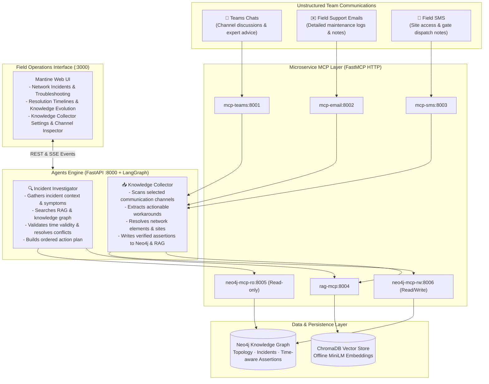
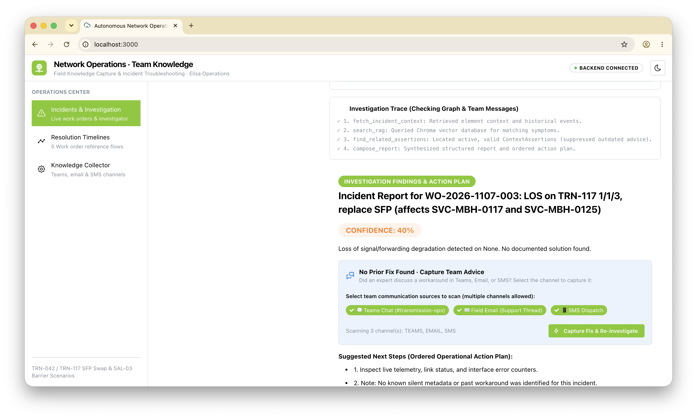
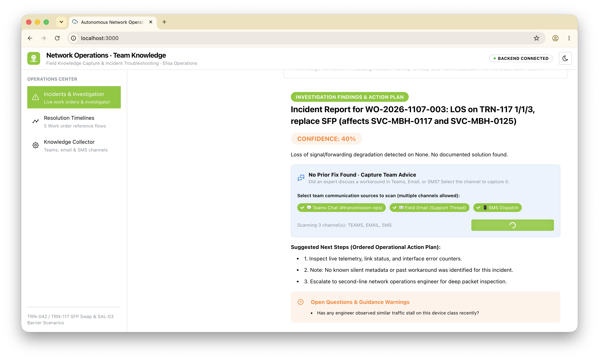
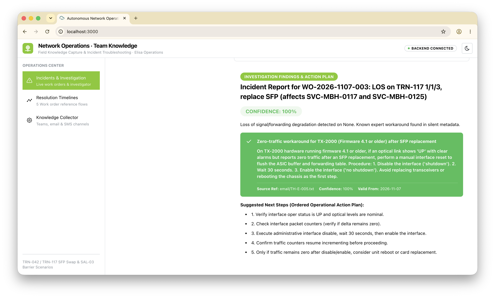
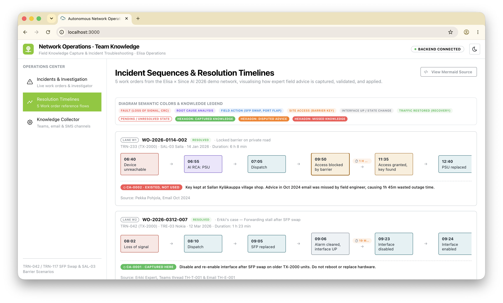
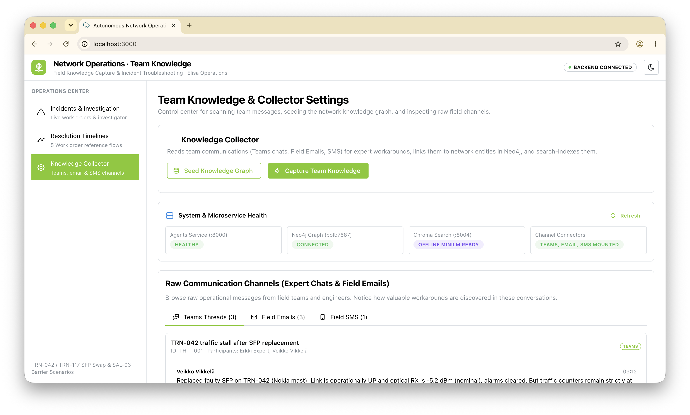

# Team Field Knowledge for Autonomous Network Operations

> **Since AI Hackathon 2026 — Elisa Challenge**  
> Turning untracked field wisdom—trapped in Teams chats, emails, and SMS—into structured, actionable knowledge that guides engineers through complex network outages.

---

## 1. The Operational Reality

In telecom network operations, the most critical troubleshooting knowledge rarely lives in official vendor documentation or central ticketing systems. It lives in:
- Quick workarounds shared in urgent **Teams channels** (`#transmission-ops`)
- Post-maintenance notes in **support email threads**
- Handover messages sent via **technician SMS**

### The SFP Forwarding Trap (Real-World Outage Scenario)
A technician travels to a remote mast (e.g., `OUL-05` at Kiiminki) to replace a degraded optical transceiver on node `TRN-117` (`TX-2000` hardware running firmware 4.1). After inserting the new SFP:
- Interface physical status shows **UP**
- Optical power levels are **nominal**
- All active alarms **clear**
- **However, traffic forwarding counters remain dead at zero bytes.**

Standard telemetry says the link is healthy, yet customer services are down. Without recorded knowledge, the technician wastes hours trying replacement optics, escalating to Tier-2, or performing a disruptive node reboot. 

Months earlier, a senior transmission engineer discovered the underlying quirk on another unit (`TRN-042`): an optical hot-swap pauses the internal forwarding ASIC. The solution is straightforward:
> **Do not replace hardware. Do not reboot the chassis.** Administratively disable the port (`shutdown`), wait 30 seconds for ASIC buffers to drain, and re-enable it (`no shutdown`).

This platform captures that trapped knowledge, binds it to the affected network entities in a graph, and puts it in the hands of the field technician the moment the same symptoms occur.

---

## 2. Platform Architecture

The system connects unstructured field communication channels to autonomous operations agents via the **Model Context Protocol (MCP)**, combining a **Neo4j Knowledge Graph** (for topology and time-aware assertions) and a **Chroma RAG Store** (for semantic symptom search).



### Time-Aware Knowledge Graph Schema
Expert guidance changes over time. An old email may say a physical key is kept at a village shop, while a newer email establishes a secure keybox at the mast gate. 

The Neo4j graph model handles this with explicit validity windows:
- `(:NetworkElement {id, model, site})`
- `(:Incident {id, title, status, symptoms})`
- `(:ContextAssertion {id, text, kind, confidence, valid_from, valid_to})`
- Relations: `[:ABOUT]`, `[:OBSERVED_IN]`, and `[:SUPERSEDES]` (when newer guidance supersedes outdated advice).

---

## 3. Operations Interface & Walkthrough

Below are the primary views in the web interface (`http://localhost:3000`), illustrating the interactive knowledge capture loop:

### 1. Incident Investigation (No Prior Fix Found)
When investigating open work order `WO-2026-1107-003` (TRN-117 Kiiminki mast), the Incident Investigator finds that alarms have cleared but traffic remains at zero, with no recorded fix in the database. Instead of failing silently, it presents an interactive capture prompt with all communication channels pre-selected.


*Shows the "No Prior Fix Found · Capture Team Advice" card with Teams, Email, and SMS chips selected.*

---

### 2. Live Knowledge Capture Action
The operator clicks **"Capture Fix & Re-investigate"**. The Knowledge Collector reads the latest communications across the selected channels, extracts the expert workaround, links it to `TRN-117` in the graph, and saves it in Chroma RAG.


*Displays the live progress notification as the Knowledge Collector scans field channels.*

---

### 3. Immediate Resolution & Actionable Plan
The Investigator re-runs automatically with the newly captured advice. The incident report updates to **100% confidence**, citing Mikko Virtanen's port flap workaround and presenting an ordered, step-by-step action plan for the technician.


*Displays the green verified workaround card, source attribution, and ordered 5-step operational checklist.*

---

### 4. Incident Sequence Timelines & Knowledge Evolution
The **Resolution Timelines** view visualizes how field knowledge evolved across five real work orders:
1. `WO-002`: The issue was first encountered, but knowledge was missed.
2. `WO-007`: Workaround discovered on TRN-042 and shared in Teams.
3. `WO-011`: Disputed advice on CRC errors flagged with conservative guidance.
4. `WO-004`: Site barrier access updated, superseding old village shop instructions.
5. `WO-003`: Today's open incident, successfully resolved with the captured workaround.


*Suggested capture: `docs/screenshots/04-incident-sequences-swimlanes.png` — Shows the 5 horizontal incident lanes with step status badges and linked knowledge hexagons.*

---

### 5. Knowledge Collector Control Center
The **Knowledge Collector** settings view monitors health across all 10 microservices and allows operators to inspect raw Teams threads, field emails, and SMS alerts.


*Suggested capture: `docs/screenshots/05-team-knowledge-collector-settings.png` — Shows service health checks, collection statistics, and the raw channel message inspector.*

---

## 4. Getting Started

### Prerequisites
- [Docker](https://docs.docker.com/get-docker/) & Docker Compose (v2.20+)
- [Git](https://git-scm.com/)
- Modern web browser (Chrome, Firefox, Safari, Edge)

### Step 1: Clone and Configure
```bash
git clone https://github.com/shahriarromy/sinceaihackathon2026-elisa.git
cd sinceaihackathon2026-elisa

# Create your local environment file
cp .env.example .env
```

> **Note on LLM Configuration**:
> By default, `.env.example` comes pre-configured with a remote OpenAI-compatible endpoint. The platform includes full deterministic extraction and fallback synthesis so that the entire demo works reliably even if external APIs are unreachable.

### Step 2: Start All Services
Launch the complete 10-container stack in the background:
```bash
docker compose up -d
```

Verify that all services report `(healthy)`:
```bash
docker compose ps
```

### Step 3: Seed Network Topology
Populate the baseline network elements, sites, and past work orders:
```bash
curl -s -X POST http://localhost:8000/seed-graph
```
*(Alternatively, run `./scripts/seed_graph.sh`)*

### Step 4: Open the Web Application
Open your browser and navigate to:
**[http://localhost:3000](http://localhost:3000)**

---

## 5. Running the Demo Scenarios

### Scenario A: Interactive SFP Forwarding Workaround (Web UI)
1. Navigate to **[http://localhost:3000](http://localhost:3000)**.
2. Click on the urgent alert banner or select incident **`WO-2026-1107-003`** (TRN-117 Kiiminki mast).
3. Click **"Investigate Incident"**.
4. Observe that the report indicates **No Prior Fix Found** with low confidence (40%) and standard escalation steps.
5. In the capture card, verify that **💬 Teams Chat**, **✉️ Field Email**, and **📱 SMS Dispatch** are selected.
6. Click **"Capture Fix & Re-investigate"**.
7. In ~2 seconds, the Knowledge Collector extracts the advice, indexes it into RAG and Neo4j, and re-investigates:
   - **Confidence increases to 100%**.
   - The verified resolution explicitly instructs: **disable port 1/1/3, wait 30 seconds, re-enable**.
   - It cautions: **Do not swap optical hardware or reboot the unit**.

### Scenario B: Automated End-to-End Acceptance Script
To run the automated verification script that executes the complete test suite:
```bash
./scripts/demo.sh
```

The script runs the complete lifecycle:
1. Health check verification on port 8000.
2. Baseline check: asserts `known_solution: null` on an unsolved incident.
3. Metadata capture: ingests communication channels.
4. Post-capture check: verifies retrieval of the port flap workaround with 100% confidence.
5. Site access check: verifies `SAL-03` barrier access code correctly supersedes the outdated village shop advice.

### Resetting for a Fresh Demo Run
To return the environment to a clean baseline at any time:
```bash
docker compose down -v
docker compose up -d
curl -s -X POST http://localhost:8000/seed-graph
```

---

## 6. Service Directory & Port Mappings

| Service | Internal Port | Host Port | Role & Technology |
|---|---|---|---|
| `ops-frontend` | 3000 | **3000** | React + Vite + Mantine UI v7 web interface |
| `ops-agents` | 8000 | **8000** | FastAPI gateway + LangGraph Incident Investigator & Knowledge Collector |
| `ops-neo4j` | 7474 / 7687 | **7474 / 7687** | Neo4j 5.26 Community (Topology & Time-aware graph) |
| `ops-neo4j-mcp-ro` | 8000 | *Internal* | FastMCP read-only Cypher tool adapter |
| `ops-neo4j-mcp-rw` | 8000 | *Internal* | FastMCP read/write Cypher tool adapter |
| `ops-chromadb` | 8000 | *Internal* | ChromaDB Vector Store (pre-downloaded MiniLM ONNX) |
| `ops-rag-mcp` | 8000 | *Internal* | FastMCP RAG wrapper (`rag_search`, `rag_add`, `rag_list_sources`) |
| `ops-mcp-teams` | 8000 | *Internal* | FastMCP adapter for Teams conversation archives |
| `ops-mcp-email` | 8000 | *Internal* | FastMCP adapter for field support emails |
| `ops-mcp-sms` | 8000 | *Internal* | FastMCP adapter for mobile technician SMS logs |

---

## 7. REST API Reference

The backend exposes an interactive OpenAPI specification at **`http://localhost:8000/docs`**:

- `GET /health`: Health status across Neo4j, Chroma, MCP tools, and Agents.
- `POST /agent1/report`: Run the Incident Investigator for a specific incident (`{"incident_id": "WO-2026-1107-003"}`).
- `POST /agent1/report/stream`: Server-Sent Events (SSE) stream broadcasting real-time investigation steps.
- `POST /agent2/ingest`: Trigger the Knowledge Collector with selective channel sources (`{"sources": ["teams", "email"], "incident_id": "WO-2026-1107-003"}`).
- `GET /incidents`: Retrieve list of all network incidents and event timelines.
- `GET /incidents/{id}`: Retrieve detailed record and telemetry for a specific work order.
- `POST /seed-graph`: Re-seed the baseline knowledge graph.

---

## 8. Built With

- **Language & Runtime**: Python 3.12 managed exclusively with [uv](https://github.com/astral-sh/uv).
- **Agent Orchestration**: [LangGraph](https://github.com/langchain-ai/langgraph) explicit state graphs.
- **Tool Protocol**: [FastMCP](https://github.com/jlowin/fastmcp) with streamable HTTP transports.
- **Graph Database**: [Neo4j 5.26](https://neo4j.com/).
- **Vector Database**: [ChromaDB](https://www.trychroma.com/) with offline all-MiniLM-L6-v2 embeddings.
- **Frontend**: React 18, Vite, TypeScript, [Mantine UI v7](https://mantine.dev/), Tabler Icons.

---

## 9. License

Developed for the **Since AI Hackathon 2026** — Elisa Challenge.
